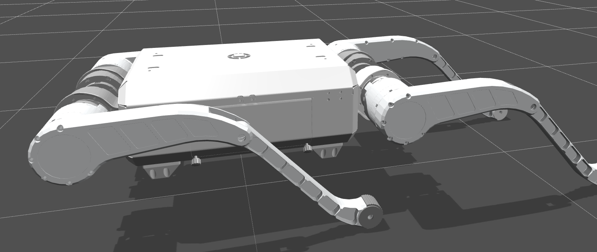
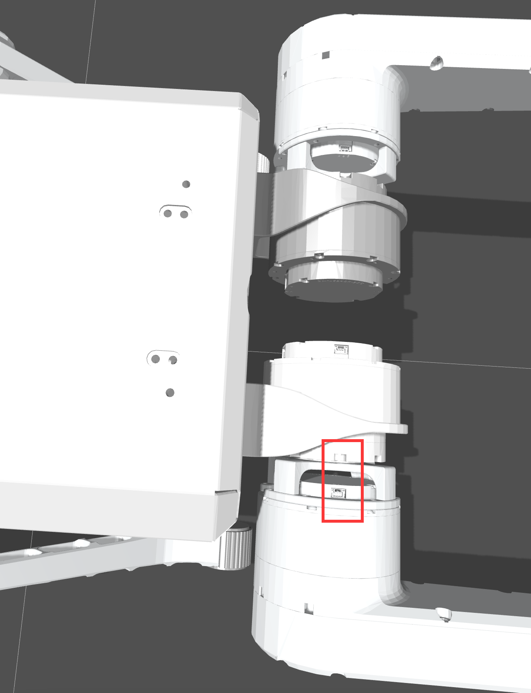

# DM1 零位改为 OpenDog 机械零位（模型内部）

2026-11-02 起，DM1 模型的关节零位直接采用 OpenDog 机械零位：

```
q（模型）= 电机角 = OpenDog URDF 关节角
旧坐标 q_old = q + (0, 0.203, 2.22)
```

`zero_offset` 改为 `(0, 0, 0)`，MJCF / `dm1_opendog.urdf` 去掉了安装旋转，标定文件
`MOTOR_ZERO_RAD` 保持全 0。机身几何与改动前完全相同（新旧 MJCF 正向运动学最大差 1.6e-12）。

## OpenDog 零位（q = 0，写零姿态）

- 髋（hip）：水平
- 大腿（thigh）：电机接口与大腿上的螺丝对齐，大腿水平朝后
- 小腿（calf）：向后伸直，顶到机械限位

这个姿态脚在 HFE 后方约 0.37 m、下方约 0.14 m，不是启动姿态。

**DM1 必须悬空写零。** OpenDog 原版文档的整机图里机器人是着地摆零位的，但 DM1 的脚着地时
大腿无法与躯干平行，只能吊起机器人、四腿离地后逐条腿摆姿态。写零时电机不输出力，
需要人手或夹具固定 12 个关节。

OpenDog 原版零位参考图（来自 open-dog `src/代码/src/docs/`，只用来看关节对齐方式）：

整机零位：髋水平，大腿水平，小腿顶到限位。



大腿电机：红框中的电机串口插座与大腿连接件上的螺丝对齐。



## 姿态角（hip, thigh, calf，rad；四条腿相同）

| 姿态 | 新模型角 | 旧模型角 | 机身高度 |
|---|---|---|---:|
| OpenDog 零位（写零） | (0, 0, 0) | (0, 0.203, 2.22) | — |
| 趴卧（启动 / 趴下保持） | (0, -0.203, -2.22) | (0, 0, 0) | ≈0.12 m |
| 起身展开 `stand_up_prepare_position` | (0, 0.1, -2.15) | (0, 0.303, 0.07) | 贴地 |
| 站立 0.24 m | (0, -0.375, -1.689) | (0, -0.172, 0.531) | 0.24 |
| **站立 0.28 m（默认 home）** | (0, -0.485961, -1.480271) | (0, -0.282961, 0.739729) | 0.28 |
| 站立 0.32 m | (0, -0.602, -1.260) | (0, -0.399, 0.960) | 0.32 |
| 站立 0.35 m | (0, -0.695, -1.083) | (0, -0.492, 1.137) | 0.35 |
| 站立 0.42 m（上限） | (0, -0.944, -0.606) | (0, -0.741, 1.614) | 0.42 |
| OpenDog 原版默认站姿 | (0, -0.700, -1.000) | (0, -0.497, 1.220) | 0.364 |

站立角保持默认站姿的足端 x（HFE 前方 22 mm）不变反解得到。电机原始读数 =
方向 × 模型角：左腿（方向 +1）就是上表数值，右腿 thigh/calf（方向 -1）取反。

## 限位与软件约束（新模型角）

| 项目 | 旧值 | 新值 |
|---|---|---|
| hip 限位 | [-1.57, 1.57] | 不变 |
| thigh 限位 | [-1.367, 2.603] | [-1.57, 2.4] |
| calf 限位 | [-0.03, 2.72] | [-2.25, 0]（0 = 写零时顶住的机械限位，不能再往正方向转） |
| 站姿 thigh 软约束 | [-0.34, -0.10] | [-0.543, -0.303] |
| 站姿 calf 软约束 | [-0.03, 1.20] | [-2.25, -1.02] |
| 进入行走的小腿最小角 | 0.30 | -1.92 |

## 改动的文件

- `include/model/robots/dm1.hpp`：零偏清零、限位、home 站姿
- `include/common/control_config.h`：新增 `pose::prone_*`；`motor_zero_position` 改名为
  `prone_home_position`（值为趴卧角）；站姿软约束、行走入口小腿角
- `include/hardware/dm1_mit_interface.hpp`：发送前限位
- `src/hardware/hardware_bridge.cpp`：启动检查改为比较趴卧姿态；`--set-zero` 提示摆 OpenDog 零位
- `src/control/opendog_robot_runner.cpp`：启动回零/趴下目标改为趴卧姿态（原来是全 0）
- `src/app/hardware_main.cpp`：提示文字
- `src/FSM/*`、`user/RobotRunner.cpp`：改用 `prone_home_position`
- `description/dm1.xml`：去掉 thigh/calf body quat、限位、home keyframe
- `config/opendog/dm1_opendog.urdf`：去掉 rpy 零偏、限位
- `config/opendog/opendog_reference.info`、`opendog_task.info`：站姿
- `config/dm1_model_contract.yaml`：`prone_home_position_rad`、零偏、限位、站姿、MJCF sha256
- 标定文件头注释、README、RUN_COMMANDS、测试

2026-11-03 起工程只保留 OpenDog 算法：上面列出的 `dm1.hpp`、`src/FSM/*`、
`user/RobotRunner.cpp`、`dm1_model_contract.yaml` 以及表中的站姿软约束、行走入口
小腿角（MIT 控制链专用）已随 MIT 控制链删除。零位、限位和趴卧姿态以
`control_config.h`、`dm1_mit_interface.hpp`、`dm1.xml`、`dm1_opendog.urdf` 为准，
URDF 与 MJCF 的一致性由 `test/model/opendog_model_contract_test.py` 检查。

## 上机步骤

1. 编译：`colcon build --packages-select dm1_robot --symlink-install`，再跑
   `colcon test --packages-select dm1_robot`。
2. 吊起机器人（四腿离地），摆成 OpenDog 零位并固定，执行 `--set-zero`。
   `--set-zero` 不检查姿态，直接写零，姿态全靠人工摆准。
3. 放下趴好，只读启动（不加 `--keyboard-control`）看 12 路 q，应接近 (0, -0.203, -2.22)。
4. 用 `--keyboard-control` 正常启动；`Shift+U` 解锁后 1.2 s 内平滑回到趴卧姿态。

注意：**电机还没按 OpenDog 零位写零之前，不能用新程序使能电机**。旧零位的电机读数在
新模型里会被理解成小腿伸直，启动检查会以约 2.2 rad 的偏差拒绝启动。
